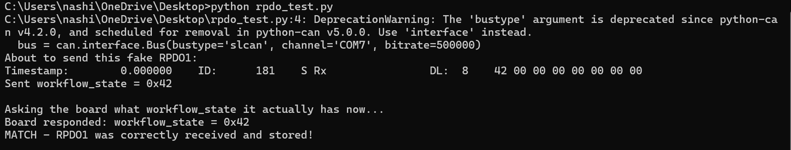
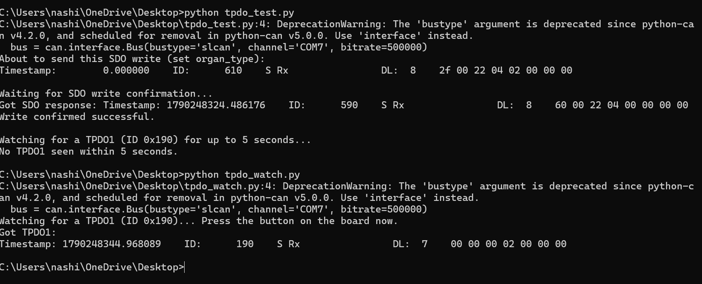
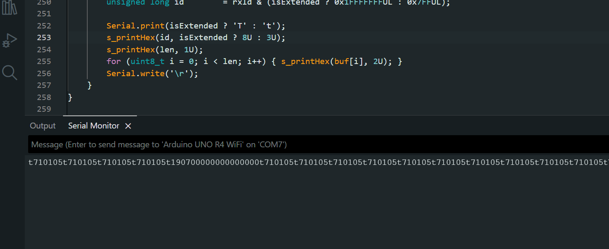

= Test Report - Display Node 0x10 (Riverdi HMI) Firmware
:doctype: article
:toc: left
:toclevels: 3
:sectnums:
:sectnumlevels: 4
:icons: font
:source-highlighter: rouge
:imagesdir: .
:revnumber: 0.1
:revdate: 2026-10-23
:author: Nashid P
:email: nashid@htic.iitm.ac.in
:docref: TR-DISP-002

[cols="1,3",options="header"]
|===
|Item |Value
|Document ID |TR-DISP-002
|Project |OrgPort - Riverdi HMI, Display Node 0x10 (STM32H757)
|Revision |0.1 (2026-10-23)
|Author |Nashid P
|Status |Draft for review
|===

== Test Report Version History

[cols="1,1,2,2,4",options="header"]
|===
|Version |Date |Author |Reviewer |Change Summary
|0.1 |2026-10-23 |Nashid P |(to be assigned) |Initial issue for the CAN-integrated display firmware
|===

== Introduction

This report records the results of the tests specified in TS-DISP-002 for the display node
(Node 0x10) firmware, including all defects and open items found while testing together with the
main controller (Node 0x04).

== Build Under Test

[cols="1,3",options="header"]
|===
|Item |Value
|Firmware |DISPLAY_RIVERDI, CM7 application, Debug configuration (release candidate 2026-10-23)
|Repository / commit |(to be filled: repository and commit hash of the tested build)
|Toolchain |STM32CubeIDE 1.19.0, GCC 13.3.1; TouchGFX 4.26.1
|Object dictionary |OrgPort_STM32_HMI_Node10.xdd (OD.c / OD.h regenerated with CANopenEditor)
|Node 0x04 firmware (HIL) |(to be filled: branch and commit of the Node 0x04 build used)
|Changes since the development build |Coding guideline conversion, PIF / middleware / application
layering of SD card, USB and CAN logger, FDCAN global filter enabled, GUI naming update
|===

[NOTE]
====
Results marked "development build" in the evidence column were obtained during development
(2026-09-23 to 2026-10-14) on earlier builds with the same functional behaviour. They must be
confirmed on the release candidate by TC-REG-001 and TC-REG-002 before release.
====

== Executive Summary

[cols="2,1,1,1,1,1",options="header"]
|===
|Area |Total |Pass |Fail |Blocked |Not run
|BLD - Build, Static Analysis and Coding Guidelines |7 |7 |0 |0 |0
|HST - Host Unit Tests - SD Card CAN Logger |6 |6 |0 |0 |0
|CAN - CANopen Protocol and Node 0x04 Interface |17 |6 |4 |0 |7
|WFL - Workflow and Screen Behaviour |34 |13 |5 |6 |10
|SBR - Status Bar and Controller Supervision |4 |2 |1 |0 |1
|ALM - Alarm Handling |14 |1 |6 |1 |6
|LOG - SD Card CAN Logging (on target) |7 |1 |0 |1 |5
|USB - USB Log Transfer |7 |0 |0 |0 |7
|NFR - Non-Functional, Robustness and Performance |6 |0 |1 |1 |4
|REG - Regression and Release Readiness |2 |0 |0 |0 |2
|*Total* |*104* |*36* |*17* |*9* |*42*
|===

=== Key Findings

* 16 defects were raised (ORPT-151 to ORPT-166): 2 Critical,
  10 Major, 4 Minor. 13 concern the display (one jointly with Node 0x04)
  and 3 concern Node 0x04.
* The CANopen interface (heartbeat, NMT, RPDO, TPDO, SDO server) and the nominal workflow on the
  bench passed on the development build.
* The CAN logger passed all host test scenarios on the release candidate source.
* Open defects on the operator interface affect data entry (organ details, weight), setpoint
  confirmation and alarm acknowledgement.
* Node 0x04 issues block a reliable start-up when Node 0x04 is powered before the display
  (ORPT-165) and keep high temperature / pressure alarms active (ORPT-164).
* 19 open items list missing features and requirement updates (manual flush, PIN, RTC,
  Safe Mode reason, battery data, SWRS baseline).

=== Recommendation

The release candidate is *not ready for release*. Before release:

. Fix the Critical defects ORPT-158 and ORPT-165 and the Major display defects.
. Execute the NOT RUN cases and the regression TC-REG-001 / TC-REG-002 on the release candidate.
. Agree the open items with the Node 0x04 team and update CIOET-ORGPORT-SWRS-RVD-2026-001 (OI-17).

== Test Environment as Executed

[cols="1,3",options="header"]
|===
|Environment |Set-up used
|BUILD |Build PC (STM32CubeIDE headless build, TouchGFX simulator build)
|HOST |Host PC unit test (MinGW GCC, real module source with stubs)
|TGFX |TouchGFX PC simulator (built-in Node 0x04 stand-in)
|BENCH |Target board + Node 0x04 bench simulator over the SLCAN bridge
|HIL |Target board + Node 0x04 main controller (S32K312) hardware
|INSP |Inspection / review of source and configuration
|===

=== Limitations

* Alarm and fault states that do not occur on the available hardware (motor, refrigeration and
  actuator failures, pressure sensor faults, emergency stop) are produced with the bench simulator.
* The SLCAN bridge occasionally stopped responding during long bench sessions. The bridge firmware
  has a watchdog and the bench simulator reconnects automatically; affected runs were repeated.
  This is a test-equipment limitation, not a DUT defect.

== Results by Area

=== BLD - Build, Static Analysis and Coding Guidelines

[cols="2,4,1,1,4,1",options="header"]
|===
|Test case |Title |Env |Result |Evidence / remarks |Defect
|<<../test_specification/TS-DISP-002_Display_Node10_Test_Specification.adoc#TC-BLD-001,TC-BLD-001>> |Target firmware builds without errors |BUILD |PASS |Headless CubeIDE + simulator build, 2026-10-23 (0 errors; 1 linker RWX warning, accepted) |-
|<<../test_specification/TS-DISP-002_Display_Node10_Test_Specification.adoc#TC-BLD-002,TC-BLD-002>> |TouchGFX simulator builds without errors |BUILD |PASS |Headless CubeIDE + simulator build, 2026-10-23 (0 errors; 1 linker RWX warning, accepted) |-
|<<../test_specification/TS-DISP-002_Display_Node10_Test_Specification.adoc#TC-BLD-003,TC-BLD-003>> |Coding guideline conformance of display-owned code |INSP |PASS |Guideline conversion review and scripted checks, 2026-10-21/23 |-
|<<../test_specification/TS-DISP-002_Display_Node10_Test_Specification.adoc#TC-BLD-004,TC-BLD-004>> |Layered architecture (PIF / middleware / application) |INSP |PASS |Scripted search, 2026-10-22 |-
|<<../test_specification/TS-DISP-002_Display_Node10_Test_Specification.adoc#TC-BLD-005,TC-BLD-005>> |No dynamic memory allocation |INSP |PASS |Scripted search, 2026-10-23 |-
|<<../test_specification/TS-DISP-002_Display_Node10_Test_Specification.adoc#TC-BLD-006,TC-BLD-006>> |GUI widget and handler names match the generated code |BUILD |PASS |Name verification script + builds, 2026-10-23 |-
|<<../test_specification/TS-DISP-002_Display_Node10_Test_Specification.adoc#TC-BLD-007,TC-BLD-007>> |Object dictionary matches the Node 0x04 interface contract |INSP |PASS |Scripted OD comparison against the Node 0x04 OD, 2026-10-13 |-
|===

=== HST - Host Unit Tests - SD Card CAN Logger

[cols="2,4,1,1,4,1",options="header"]
|===
|Test case |Title |Env |Result |Evidence / remarks |Defect
|<<../test_specification/TS-DISP-002_Display_Node10_Test_Specification.adoc#TC-HST-001,TC-HST-001>> |Logging with no Node 0x04 on the bus |HOST |PASS |test/host_canlog/run_host_test.sh on the release candidate source: PASS, 16 files identical to expected/; check_canlog.py CRC chain OK (2026-10-23) |-
|<<../test_specification/TS-DISP-002_Display_Node10_Test_Specification.adoc#TC-HST-002,TC-HST-002>> |Idle logging while Node 0x04 stays in IDLE |HOST |PASS |test/host_canlog/run_host_test.sh on the release candidate source: PASS, 16 files identical to expected/; check_canlog.py CRC chain OK (2026-10-23) |-
|<<../test_specification/TS-DISP-002_Display_Node10_Test_Specification.adoc#TC-HST-003,TC-HST-003>> |Complete session file with END line |HOST |PASS |test/host_canlog/run_host_test.sh on the release candidate source: PASS, 16 files identical to expected/; check_canlog.py CRC chain OK (2026-10-23) |-
|<<../test_specification/TS-DISP-002_Display_Node10_Test_Specification.adoc#TC-HST-004,TC-HST-004>> |Queue overflow and power cut during a session |HOST |PASS |test/host_canlog/run_host_test.sh on the release candidate source: PASS, 16 files identical to expected/; check_canlog.py CRC chain OK (2026-10-23) |-
|<<../test_specification/TS-DISP-002_Display_Node10_Test_Specification.adoc#TC-HST-005,TC-HST-005>> |Resume after a power cut continues as _PART2 |HOST |PASS |test/host_canlog/run_host_test.sh on the release candidate source: PASS, 16 files identical to expected/; check_canlog.py CRC chain OK (2026-10-23) |-
|<<../test_specification/TS-DISP-002_Display_Node10_Test_Specification.adoc#TC-HST-006,TC-HST-006>> |New session after the controller restarted in IDLE |HOST |PASS |test/host_canlog/run_host_test.sh on the release candidate source: PASS, 16 files identical to expected/; check_canlog.py CRC chain OK (2026-10-23) |-
|===

=== CAN - CANopen Protocol and Node 0x04 Interface

[cols="2,4,1,1,4,1",options="header"]
|===
|Test case |Title |Env |Result |Evidence / remarks |Defect
|<<../test_specification/TS-DISP-002_Display_Node10_Test_Specification.adoc#TC-CAN-001,TC-CAN-001>> |Heartbeat production 0x710 every 500 ms |BENCH |PASS |FIG-CAN-01 (development build, 2026-09-24) (see <<FIG-CAN-01,FIG-CAN-01>>) |-
|<<../test_specification/TS-DISP-002_Display_Node10_Test_Specification.adoc#TC-CAN-002,TC-CAN-002>> |Boot-up message and Pre-Operational state |BENCH |NOT RUN |- |-
|<<../test_specification/TS-DISP-002_Display_Node10_Test_Specification.adoc#TC-CAN-003,TC-CAN-003>> |Autonomous transition to Operational when Node 0x04 is Operational |BENCH |NOT RUN |- |-
|<<../test_specification/TS-DISP-002_Display_Node10_Test_Specification.adoc#TC-CAN-004,TC-CAN-004>> |NMT Start command accepted |BENCH |PASS |FIG-CAN-02 (development build, 2026-09-23) (see <<FIG-CAN-02,FIG-CAN-02>>) |-
|<<../test_specification/TS-DISP-002_Display_Node10_Test_Specification.adoc#TC-CAN-005,TC-CAN-005>> |RPDO1 0x181 reception and storage |BENCH |PASS |FIG-CAN-03 (development build, 2026-09-24) (see <<FIG-CAN-03,FIG-CAN-03>>) |-
|<<../test_specification/TS-DISP-002_Display_Node10_Test_Specification.adoc#TC-CAN-006,TC-CAN-006>> |RPDO2-RPDO7 decoding and scaling |BENCH |NOT RUN |- |-
|<<../test_specification/TS-DISP-002_Display_Node10_Test_Specification.adoc#TC-CAN-007,TC-CAN-007>> |RPDO timeout handling (3 s event timer) |BENCH |NOT RUN |- |-
|<<../test_specification/TS-DISP-002_Display_Node10_Test_Specification.adoc#TC-CAN-008,TC-CAN-008>> |SDO server on 0x610/0x590 |BENCH |PASS |FIG-CAN-04 (development build, 2026-09-24) (see <<FIG-CAN-04,FIG-CAN-04>>) |-
|<<../test_specification/TS-DISP-002_Display_Node10_Test_Specification.adoc#TC-CAN-009,TC-CAN-009>> |TPDO1 0x190 operator input frame |BENCH |PASS |FIG-CAN-04, FIG-CAN-05 (development build, 2026-09-24) (see <<FIG-CAN-04,FIG-CAN-04>>, <<FIG-CAN-05,FIG-CAN-05>>) |-
|<<../test_specification/TS-DISP-002_Display_Node10_Test_Specification.adoc#TC-CAN-010,TC-CAN-010>> |Confirm handshake (counter + current state) |BENCH |PASS |Bench session traces m1_bench_sim/logs (development build, 2026-10-13/14) |-
|<<../test_specification/TS-DISP-002_Display_Node10_Test_Specification.adoc#TC-CAN-011,TC-CAN-011>> |Confirm timeout when Node 0x04 does not accept |BENCH |*FAIL* |Code review 2026-10-23: popup closes silently (see <<FIG-S01-02,FIG-S01-02>>) |ORPT-162
|<<../test_specification/TS-DISP-002_Display_Node10_Test_Specification.adoc#TC-CAN-012,TC-CAN-012>> |SDO client actions to Node 0x04 (ack, pause-resolve, diag) |BENCH |NOT RUN |- |-
|<<../test_specification/TS-DISP-002_Display_Node10_Test_Specification.adoc#TC-CAN-013,TC-CAN-013>> |Setpoint write to Node 0x04 object 0x2201 |BENCH |NOT RUN |- |-
|<<../test_specification/TS-DISP-002_Display_Node10_Test_Specification.adoc#TC-CAN-014,TC-CAN-014>> |Rejected setpoint is detected by the display |BENCH |*FAIL* |Code review 2026-10-23: no read-back, Screen 14 opens directly |ORPT-154
|<<../test_specification/TS-DISP-002_Display_Node10_Test_Specification.adoc#TC-CAN-015,TC-CAN-015>> |Hardware receive filter rejects unrelated frames |BENCH |NOT RUN |- |-
|<<../test_specification/TS-DISP-002_Display_Node10_Test_Specification.adoc#TC-CAN-016,TC-CAN-016>> |CANopen communication reset (NMT 0x82) |BENCH |*FAIL* |Code review 2026-10-23: receive filters cannot be re-registered |ORPT-159
|<<../test_specification/TS-DISP-002_Display_Node10_Test_Specification.adoc#TC-CAN-017,TC-CAN-017>> |Node 0x04 start-up when it is alone on the bus |HIL |*FAIL* |Hardware session logs (SD card), 2026-10: Node 0x04 latches CAN TX overflow EMCY and stays Pre-Operational (see <<FIG-SB-02,FIG-SB-02>>) |ORPT-165
|===

=== WFL - Workflow and Screen Behaviour

[cols="2,4,1,1,4,1",options="header"]
|===
|Test case |Title |Env |Result |Evidence / remarks |Defect
|<<../test_specification/TS-DISP-002_Display_Node10_Test_Specification.adoc#TC-WFL-001,TC-WFL-001>> |Screen 1 idle content |BENCH |PASS |Bench session (development build, 2026-10-13/14), m1_bench_sim/logs (see <<FIG-S01-01,FIG-S01-01>>, <<FIG-SB-01,FIG-SB-01>>) |-
|<<../test_specification/TS-DISP-002_Display_Node10_Test_Specification.adoc#TC-WFL-002,TC-WFL-002>> |Screen 1 Continue starts a session |BENCH |PASS |Bench session (development build, 2026-10-13/14), m1_bench_sim/logs (see <<FIG-S01-02,FIG-S01-02>>) |-
|<<../test_specification/TS-DISP-002_Display_Node10_Test_Specification.adoc#TC-WFL-003,TC-WFL-003>> |Screen 1 Continue while Node 0x04 is offline |BENCH |NOT RUN |- |-
|<<../test_specification/TS-DISP-002_Display_Node10_Test_Specification.adoc#TC-WFL-004,TC-WFL-004>> |Screen 1 resumes the screen of a running session |BENCH |NOT RUN |- |-
|<<../test_specification/TS-DISP-002_Display_Node10_Test_Specification.adoc#TC-WFL-005,TC-WFL-005>> |Screen 1 sensor and subsystem validation |HIL |BLOCKED |Not implemented: the popup only waits for the Node 0x04 confirm (OI-07) |-
|<<../test_specification/TS-DISP-002_Display_Node10_Test_Specification.adoc#TC-WFL-006,TC-WFL-006>> |Screen 2 PIN entry and masking |TGFX |NOT RUN |- |-
|<<../test_specification/TS-DISP-002_Display_Node10_Test_Specification.adoc#TC-WFL-007,TC-WFL-007>> |Screen 2 authentication against Node 0x04 |BENCH |BLOCKED |PIN verification not defined (OI-06); any 6-digit PIN is accepted |-
|<<../test_specification/TS-DISP-002_Display_Node10_Test_Specification.adoc#TC-WFL-008,TC-WFL-008>> |Screen 3 organ selection and defaults |BENCH |PASS |Bench session (development build, 2026-10-13/14), m1_bench_sim/logs (see <<FIG-S03-01,FIG-S03-01>>) |-
|<<../test_specification/TS-DISP-002_Display_Node10_Test_Specification.adoc#TC-WFL-009,TC-WFL-009>> |Screen 4 temperature override bands |TGFX |NOT RUN |- |-
|<<../test_specification/TS-DISP-002_Display_Node10_Test_Specification.adoc#TC-WFL-010,TC-WFL-010>> |Screen 5 thermal stabilisation gate |BENCH |PASS |Bench sweep (development build, 2026-10) (see <<FIG-S05-01,FIG-S05-01>>, <<FIG-S05-02,FIG-S05-02>>) |-
|<<../test_specification/TS-DISP-002_Display_Node10_Test_Specification.adoc#TC-WFL-011,TC-WFL-011>> |Screen 6 reservoir fill follows Node 0x04 |BENCH |PASS |Bench session (development build, 2026-10-13/14), m1_bench_sim/logs (see <<FIG-S06-01,FIG-S06-01>>, <<FIG-S06-02,FIG-S06-02>>) |-
|<<../test_specification/TS-DISP-002_Display_Node10_Test_Specification.adoc#TC-WFL-012,TC-WFL-012>> |Screen 6 fill ends only on the level sensor |HIL |BLOCKED |Requires Node 0x04 change (OI-01) |-
|<<../test_specification/TS-DISP-002_Display_Node10_Test_Specification.adoc#TC-WFL-013,TC-WFL-013>> |Screen 7 priming and bubble detection stages |BENCH |PASS |Bench session (development build, 2026-10-13/14), m1_bench_sim/logs (see <<FIG-S07-01,FIG-S07-01>>, <<FIG-S07-02,FIG-S07-02>>, <<FIG-S07-03,FIG-S07-03>>) |-
|<<../test_specification/TS-DISP-002_Display_Node10_Test_Specification.adoc#TC-WFL-014,TC-WFL-014>> |Screen 8 organ details entry |TGFX |*FAIL* |Reported by tester on target: Harvest Hospital text appears in the Destination field (see <<FIG-S08-01,FIG-S08-01>>, <<FIG-S08-02,FIG-S08-02>>) |ORPT-151
|<<../test_specification/TS-DISP-002_Display_Node10_Test_Specification.adoc#TC-WFL-015,TC-WFL-015>> |Screen 8 field length |TGFX |*FAIL* |Code review: Destination buffer holds 9 characters |ORPT-152
|<<../test_specification/TS-DISP-002_Display_Node10_Test_Specification.adoc#TC-WFL-016,TC-WFL-016>> |Screen 8 weight accepts digits only |TGFX |*FAIL* |Code review: letters accepted; abc sent as 0 g, 12a5 as 12 g |ORPT-153
|<<../test_specification/TS-DISP-002_Display_Node10_Test_Specification.adoc#TC-WFL-017,TC-WFL-017>> |Screen 9 preservation mode routing |BENCH |PASS |Bench session (development build, 2026-10-13/14), m1_bench_sim/logs (see <<FIG-S09-01,FIG-S09-01>>) |-
|<<../test_specification/TS-DISP-002_Display_Node10_Test_Specification.adoc#TC-WFL-018,TC-WFL-018>> |Screens 10-11 oxygenator connection and priming |TGFX |NOT RUN |- |-
|<<../test_specification/TS-DISP-002_Display_Node10_Test_Specification.adoc#TC-WFL-019,TC-WFL-019>> |Screen 12 recommended configuration |TGFX |NOT RUN |- |-
|<<../test_specification/TS-DISP-002_Display_Node10_Test_Specification.adoc#TC-WFL-020,TC-WFL-020>> |Screen 13 advanced override limits |TGFX |*FAIL* |Code review: limits are 0-20 degC and 0-100 mmHg (see <<FIG-S13-01,FIG-S13-01>>) |ORPT-155
|<<../test_specification/TS-DISP-002_Display_Node10_Test_Specification.adoc#TC-WFL-021,TC-WFL-021>> |Screen 13 confirm is acknowledged |BENCH |*FAIL* |Code review: Screen 14 opens immediately after sending |ORPT-154
|<<../test_specification/TS-DISP-002_Display_Node10_Test_Specification.adoc#TC-WFL-022,TC-WFL-022>> |Screen 14 system ready and organ loading confirm |BENCH |PASS |Bench session (development build, 2026-10-13/14), m1_bench_sim/logs (see <<FIG-S14-01,FIG-S14-01>>) |-
|<<../test_specification/TS-DISP-002_Display_Node10_Test_Specification.adoc#TC-WFL-023,TC-WFL-023>> |Screen 15 dashboard values |BENCH |PASS |Bench session (development build, 2026-10-13/14), m1_bench_sim/logs (see <<FIG-S15-01,FIG-S15-01>>) |-
|<<../test_specification/TS-DISP-002_Display_Node10_Test_Specification.adoc#TC-WFL-024,TC-WFL-024>> |Screen 15 battery overlay |TGFX |BLOCKED |Battery values are simulated; no battery data source (OI-11) |-
|<<../test_specification/TS-DISP-002_Display_Node10_Test_Specification.adoc#TC-WFL-025,TC-WFL-025>> |Screen 15 manual flush |HIL |BLOCKED |Feature not implemented; needs Node 0x04 support (OI-02) |-
|<<../test_specification/TS-DISP-002_Display_Node10_Test_Specification.adoc#TC-WFL-026,TC-WFL-026>> |Screen 15 End Procedure |BENCH |PASS |Bench session (development build, 2026-10-13/14), m1_bench_sim/logs |-
|<<../test_specification/TS-DISP-002_Display_Node10_Test_Specification.adoc#TC-WFL-027,TC-WFL-027>> |Screen 16 arrival checklist order |TGFX |NOT RUN |- |-
|<<../test_specification/TS-DISP-002_Display_Node10_Test_Specification.adoc#TC-WFL-028,TC-WFL-028>> |Screen 16 arrival confirm |BENCH |PASS |Bench session (development build, 2026-10-13/14), m1_bench_sim/logs |-
|<<../test_specification/TS-DISP-002_Display_Node10_Test_Specification.adoc#TC-WFL-029,TC-WFL-029>> |Screen 17 transport summary |BENCH |PASS |Bench session (development build, 2026-10-13/14), m1_bench_sim/logs (see <<FIG-S17-01,FIG-S17-01>>) |-
|<<../test_specification/TS-DISP-002_Display_Node10_Test_Specification.adoc#TC-WFL-030,TC-WFL-030>> |Screen 17 saving history step |BENCH |BLOCKED |Placeholder animation only (OI-10) |-
|<<../test_specification/TS-DISP-002_Display_Node10_Test_Specification.adoc#TC-WFL-031,TC-WFL-031>> |Screen 18 power-off gating |TGFX |NOT RUN |- |-
|<<../test_specification/TS-DISP-002_Display_Node10_Test_Specification.adoc#TC-WFL-032,TC-WFL-032>> |Full nominal session on the bench |BENCH |PASS |Bench session (development build, 2026-10-13/14), m1_bench_sim/logs |-
|<<../test_specification/TS-DISP-002_Display_Node10_Test_Specification.adoc#TC-WFL-033,TC-WFL-033>> |Full nominal session with Node 0x04 hardware |HIL |NOT RUN |Partial hardware runs during development; complete run pending |-
|<<../test_specification/TS-DISP-002_Display_Node10_Test_Specification.adoc#TC-WFL-034,TC-WFL-034>> |Flow walk-through in the TouchGFX simulator |TGFX |NOT RUN |- |-
|===

=== SBR - Status Bar and Controller Supervision

[cols="2,4,1,1,4,1",options="header"]
|===
|Test case |Title |Env |Result |Evidence / remarks |Defect
|<<../test_specification/TS-DISP-002_Display_Node10_Test_Specification.adoc#TC-SBR-001,TC-SBR-001>> |Status bar content on every screen |TGFX |NOT RUN |- |-
|<<../test_specification/TS-DISP-002_Display_Node10_Test_Specification.adoc#TC-SBR-002,TC-SBR-002>> |GPS indicator |BENCH |PASS |Bench session (development build, 2026-10-13/14), m1_bench_sim/logs |-
|<<../test_specification/TS-DISP-002_Display_Node10_Test_Specification.adoc#TC-SBR-003,TC-SBR-003>> |Controller offline detection (heartbeat timeout) |BENCH |PASS |Bench session (development build, 2026-10-13/14), m1_bench_sim/logs (see <<FIG-SB-02,FIG-SB-02>>) |-
|<<../test_specification/TS-DISP-002_Display_Node10_Test_Specification.adoc#TC-SBR-004,TC-SBR-004>> |Operator-facing wording |INSP |*FAIL* |Code review 2026-10-23: 7 texts use the internal name |ORPT-163
|===

=== ALM - Alarm Handling

[cols="2,4,1,1,4,1",options="header"]
|===
|Test case |Title |Env |Result |Evidence / remarks |Defect
|<<../test_specification/TS-DISP-002_Display_Node10_Test_Specification.adoc#TC-ALM-001,TC-ALM-001>> |Alarm centre shows active alarms |BENCH |PASS |Bench session (development build, 2026-10-13/14), m1_bench_sim/logs (see <<FIG-ALM-01,FIG-ALM-01>>) |-
|<<../test_specification/TS-DISP-002_Display_Node10_Test_Specification.adoc#TC-ALM-002,TC-ALM-002>> |Alarm cards per alarm_flags bit |BENCH |NOT RUN |- |-
|<<../test_specification/TS-DISP-002_Display_Node10_Test_Specification.adoc#TC-ALM-003,TC-ALM-003>> |Alarm acknowledge |BENCH |NOT RUN |- |-
|<<../test_specification/TS-DISP-002_Display_Node10_Test_Specification.adoc#TC-ALM-004,TC-ALM-004>> |Alarms clear when the condition returns to normal |HIL |*FAIL* |Reported by tester on target; Node 0x04 clears the bit only on acknowledge |ORPT-164
|<<../test_specification/TS-DISP-002_Display_Node10_Test_Specification.adoc#TC-ALM-005,TC-ALM-005>> |Alarm Silence |TGFX |*FAIL* |Silence has no function; no buzzer or silence object |ORPT-160
|<<../test_specification/TS-DISP-002_Display_Node10_Test_Specification.adoc#TC-ALM-006,TC-ALM-006>> |More than eight simultaneous alarms |BENCH |*FAIL* |Code review: alarm centre holds 8 cards |ORPT-161
|<<../test_specification/TS-DISP-002_Display_Node10_Test_Specification.adoc#TC-ALM-007,TC-ALM-007>> |Dashboard critical alarm popup |BENCH |*FAIL* |Reported by tester on target: note line cut off (see <<FIG-S15-03,FIG-S15-03>>) |ORPT-157
|<<../test_specification/TS-DISP-002_Display_Node10_Test_Specification.adoc#TC-ALM-008,TC-ALM-008>> |Dashboard critical popup acknowledge |BENCH |*FAIL* |Reported by tester on target / code review: popup only hides, nothing is sent |ORPT-156
|<<../test_specification/TS-DISP-002_Display_Node10_Test_Specification.adoc#TC-ALM-009,TC-ALM-009>> |Motor diagnostic decision (bit 16) |BENCH |NOT RUN |- |-
|<<../test_specification/TS-DISP-002_Display_Node10_Test_Specification.adoc#TC-ALM-010,TC-ALM-010>> |Session resume decision (bit 18) |BENCH |NOT RUN |- |-
|<<../test_specification/TS-DISP-002_Display_Node10_Test_Specification.adoc#TC-ALM-011,TC-ALM-011>> |Pressure range decision (bit 19) |BENCH |NOT RUN |- |-
|<<../test_specification/TS-DISP-002_Display_Node10_Test_Specification.adoc#TC-ALM-012,TC-ALM-012>> |Decision popup while Node 0x04 is offline or not answering |BENCH |NOT RUN |- |-
|<<../test_specification/TS-DISP-002_Display_Node10_Test_Specification.adoc#TC-ALM-013,TC-ALM-013>> |Resume prompt after power loss during priming |HIL |*FAIL* |Reported by tester on target: no popup (see <<FIG-ALM-03,FIG-ALM-03>>) |ORPT-158
|<<../test_specification/TS-DISP-002_Display_Node10_Test_Specification.adoc#TC-ALM-014,TC-ALM-014>> |Safe Mode Active alarm and reason |HIL |BLOCKED |Reason display pending Node 0x04 team answer (OI-04, OI-05) |-
|===

=== LOG - SD Card CAN Logging (on target)

[cols="2,4,1,1,4,1",options="header"]
|===
|Test case |Title |Env |Result |Evidence / remarks |Defect
|<<../test_specification/TS-DISP-002_Display_Node10_Test_Specification.adoc#TC-LOG-001,TC-LOG-001>> |SD card detection, mount and file creation |HIL |PASS |Hardware session SD logs (development build, 2026-10) (see <<FIG-LOG-01,FIG-LOG-01>>) |-
|<<../test_specification/TS-DISP-002_Display_Node10_Test_Specification.adoc#TC-LOG-002,TC-LOG-002>> |Log integrity check |HIL |NOT RUN |- |-
|<<../test_specification/TS-DISP-002_Display_Node10_Test_Specification.adoc#TC-LOG-003,TC-LOG-003>> |Card removed and re-inserted during a session |HIL |NOT RUN |- |-
|<<../test_specification/TS-DISP-002_Display_Node10_Test_Specification.adoc#TC-LOG-004,TC-LOG-004>> |Power cut during a session |HIL |NOT RUN |- |-
|<<../test_specification/TS-DISP-002_Display_Node10_Test_Specification.adoc#TC-LOG-005,TC-LOG-005>> |No card / unreadable card |HIL |NOT RUN |- |-
|<<../test_specification/TS-DISP-002_Display_Node10_Test_Specification.adoc#TC-LOG-006,TC-LOG-006>> |Queue load and dropped frames |BENCH |NOT RUN |- |-
|<<../test_specification/TS-DISP-002_Display_Node10_Test_Specification.adoc#TC-LOG-007,TC-LOG-007>> |Operator inputs are logged |HIL |BLOCKED |Not implemented (OI-03) |-
|===

=== USB - USB Log Transfer

[cols="2,4,1,1,4,1",options="header"]
|===
|Test case |Title |Env |Result |Evidence / remarks |Defect
|<<../test_specification/TS-DISP-002_Display_Node10_Test_Specification.adoc#TC-USB-001,TC-USB-001>> |Copy only on Screen 18 |HIL |NOT RUN |- |-
|<<../test_specification/TS-DISP-002_Display_Node10_Test_Specification.adoc#TC-USB-002,TC-USB-002>> |Copy result and size check |HIL |NOT RUN |- |-
|<<../test_specification/TS-DISP-002_Display_Node10_Test_Specification.adoc#TC-USB-003,TC-USB-003>> |Files already on the stick are skipped |HIL |NOT RUN |- |-
|<<../test_specification/TS-DISP-002_Display_Node10_Test_Specification.adoc#TC-USB-004,TC-USB-004>> |Cancel during copy |HIL |NOT RUN |- |-
|<<../test_specification/TS-DISP-002_Display_Node10_Test_Specification.adoc#TC-USB-005,TC-USB-005>> |Stick pulled out during copy |HIL |NOT RUN |- |-
|<<../test_specification/TS-DISP-002_Display_Node10_Test_Specification.adoc#TC-USB-006,TC-USB-006>> |Stick without SD card |HIL |NOT RUN |- |-
|<<../test_specification/TS-DISP-002_Display_Node10_Test_Specification.adoc#TC-USB-007,TC-USB-007>> |Logging continues during the copy |HIL |NOT RUN |- |-
|===

=== NFR - Non-Functional, Robustness and Performance

[cols="2,4,1,1,4,1",options="header"]
|===
|Test case |Title |Env |Result |Evidence / remarks |Defect
|<<../test_specification/TS-DISP-002_Display_Node10_Test_Specification.adoc#TC-NFR-001,TC-NFR-001>> |Start-up time |HIL |NOT RUN |- |-
|<<../test_specification/TS-DISP-002_Display_Node10_Test_Specification.adoc#TC-NFR-002,TC-NFR-002>> |HMI update latency |BENCH |NOT RUN |- |-
|<<../test_specification/TS-DISP-002_Display_Node10_Test_Specification.adoc#TC-NFR-003,TC-NFR-003>> |Alarm activation latency |BENCH |NOT RUN |- |-
|<<../test_specification/TS-DISP-002_Display_Node10_Test_Specification.adoc#TC-NFR-004,TC-NFR-004>> |Long-duration session (8 h) |BENCH |NOT RUN |- |-
|<<../test_specification/TS-DISP-002_Display_Node10_Test_Specification.adoc#TC-NFR-005,TC-NFR-005>> |Real-time clock |HIL |BLOCKED |RTC not integrated (OI-08, OI-09) |-
|<<../test_specification/TS-DISP-002_Display_Node10_Test_Specification.adoc#TC-NFR-006,TC-NFR-006>> |Node 0x04 recovers from a generic error |HIL |*FAIL* |Node 0x04 code review: error reset never called |ORPT-166
|===

=== REG - Regression and Release Readiness

[cols="2,4,1,1,4,1",options="header"]
|===
|Test case |Title |Env |Result |Evidence / remarks |Defect
|<<../test_specification/TS-DISP-002_Display_Node10_Test_Specification.adoc#TC-REG-001,TC-REG-001>> |Regression on the release candidate after refactoring |BENCH |NOT RUN |- |-
|<<../test_specification/TS-DISP-002_Display_Node10_Test_Specification.adoc#TC-REG-002,TC-REG-002>> |Regression with Node 0x04 hardware |HIL |NOT RUN |- |-
|===

== Defect Register

[cols="1,4,2,1,2",options="header"]
|===
|Jira |Title |Component |Severity |Found by
|ORPT-151 |Organ Details: Harvest Hospital text appears in the Destination field |Display Node 0x10 |Major |TC-WFL-014
|ORPT-152 |Organ Details: Destination Institution limited to 9 characters |Display Node 0x10 |Minor |TC-WFL-015
|ORPT-153 |Organ Details: Weight field accepts non-numeric characters |Display Node 0x10 |Major |TC-WFL-016
|ORPT-154 |Advanced configuration: setpoint acceptance is not verified |Display Node 0x10 |Major |TC-CAN-014, TC-WFL-021
|ORPT-155 |Advanced configuration: limits exceed the range accepted by Node 0x04 |Display Node 0x10 |Major |TC-WFL-020
|ORPT-156 |Dashboard critical popup: Acknowledge does not acknowledge |Display Node 0x10 |Major |TC-ALM-008
|ORPT-157 |Dashboard critical popup: grey note line cut off |Display Node 0x10 |Minor |TC-ALM-007
|ORPT-158 |Resume / Abandon prompt missing after power loss during priming |Display Node 0x10 / Main controller Node 0x04 |Critical |TC-ALM-013
|ORPT-159 |CANopen communication reset (NMT 0x82) is not supported |Display Node 0x10 |Major |TC-CAN-016
|ORPT-160 |Alarm card Silence button has no function |Display Node 0x10 |Minor |TC-ALM-005
|ORPT-161 |Alarm centre shows at most 8 alarms |Display Node 0x10 |Major |TC-ALM-006
|ORPT-162 |Session start refused without operator feedback |Display Node 0x10 |Major |TC-CAN-011
|ORPT-163 |Operator texts use the internal development name of the controller |Display Node 0x10 |Minor |TC-SBR-004
|ORPT-164 |Temperature / pressure high alarms do not clear by themselves |Main controller Node 0x04 |Major |TC-ALM-004
|ORPT-165 |Node 0x04 stays Pre-Operational after CAN TX overflow at power-on |Main controller Node 0x04 |Critical |TC-CAN-017
|ORPT-166 |Node 0x04 never resets CANopen errors |Main controller Node 0x04 |Major |TC-NFR-006
|===

[[ORPT-151]]
=== ORPT-151 - Organ Details: Harvest Hospital text appears in the Destination field

[cols="1,4"]
|===
|Component |Display Node 0x10
|Severity |Major
|Status |Open
|Found by |TC-WFL-014
|Description |On Screen 8, text typed in the third field (Harvest Hospital) is also shown in the fourth field (Destination Institution).
|Expected |Each field shows only its own text.
|Actual |Destination shows the Harvest Hospital text.
|Proposed fix |Find the cause on target (field wiring in View and generated code reviewed and correct; check keyboard target switching and the 10-character Destination buffer, see ORPT-152).
|===

[[ORPT-152]]
=== ORPT-152 - Organ Details: Destination Institution limited to 9 characters

[cols="1,4"]
|===
|Component |Display Node 0x10
|Severity |Minor
|Status |Open
|Found by |TC-WFL-015
|Description |The Destination Institution wildcard buffer is 10 characters (9 usable); Harvest Hospital has 25.
|Expected |Same capacity for both institution names.
|Actual |Longer destination names are cut off.
|Proposed fix |Increase the wildcard buffer size of btnDestinationInstitution in TouchGFX Designer.
|===

[[ORPT-153]]
=== ORPT-153 - Organ Details: Weight field accepts non-numeric characters

[cols="1,4"]
|===
|Component |Display Node 0x10
|Severity |Major
|Status |Open
|Found by |TC-WFL-016
|Description |The Weight field uses the full keyboard; parsing stops at the first non-digit.
|Expected |Digits only; the weight sent equals the typed value.
|Actual |'abc' is sent as 0 g and '12a5' as 12 g, without warning.
|Proposed fix |Restrict the field to digits (numeric keypad or filter in characterTyped) and validate before Continue.
|===

[[ORPT-154]]
=== ORPT-154 - Advanced configuration: setpoint acceptance is not verified

[cols="1,4"]
|===
|Component |Display Node 0x10
|Severity |Major
|Status |Open
|Found by |TC-CAN-014, TC-WFL-021
|Description |Screen 13 Confirm sends the setpoints and opens Screen 14 immediately; the display does not read 0x2201 back, although Node 0x04 restores the old value when it rejects a setpoint.
|Expected |The operator sees whether the new setpoints were accepted.
|Actual |A rejected or failed setpoint is not noticed.
|Proposed fix |Read 0x2201 back after the write; stay on Screen 13 with a message on rejection or failure.
|===

[[ORPT-155]]
=== ORPT-155 - Advanced configuration: limits exceed the range accepted by Node 0x04

[cols="1,4"]
|===
|Component |Display Node 0x10
|Severity |Major
|Status |Open
|Found by |TC-WFL-020
|Description |Screen 13 allows 0-20 degC and 0-100 mmHg; Node 0x04 accepts 0-15 degC and 0-50 mmHg.
|Expected |The screen limits match the controller limits.
|Actual |Values above 15 degC / 50 mmHg can be confirmed and are rejected by Node 0x04.
|Proposed fix |Set TEMP_MAX_C = 15 and PRESSURE_MAX_MMHG = 50 in Screen13View.
|===

[[ORPT-156]]
=== ORPT-156 - Dashboard critical popup: Acknowledge does not acknowledge

[cols="1,4"]
|===
|Component |Display Node 0x10
|Severity |Major
|Status |Open
|Found by |TC-ALM-008
|Description |The Acknowledge button of the Screen 15 critical popup is wired in Designer to hide the container; the View handler that sends the acknowledgement is never called.
|Expected |Acknowledgement written to Node 0x04 and popup closed.
|Actual |Popup hidden locally only; the alarm stays active in Node 0x04.
|Proposed fix |Replace the Designer hide action by the custom handler that calls acknowledgeAlarms().
|===

[[ORPT-157]]
=== ORPT-157 - Dashboard critical popup: grey note line cut off

[cols="1,4"]
|===
|Component |Display Node 0x10
|Severity |Minor
|Status |Open
|Found by |TC-ALM-007
|Description |The second (grey) line of the critical popup, e.g. for Safe Mode Active, is not fully visible.
|Expected |Full text visible.
|Actual |Text truncated.
|Proposed fix |Enlarge textCriticalNote in Designer or shorten the text.
|===

[[ORPT-158]]
=== ORPT-158 - Resume / Abandon prompt missing after power loss during priming

[cols="1,4"]
|===
|Component |Display Node 0x10 / Main controller Node 0x04
|Severity |Critical
|Status |Open
|Found by |TC-ALM-013
|Description |After a full power cycle during PRIMING no Resume / Abandon popup was shown. Node 0x04 stores PRIMING as an active session and raises bit 18 after boot.
|Expected |Resume / Abandon popup shown after restart.
|Actual |No popup; session state unclear to the operator.
|Proposed fix |Reproduce with a CAN trace from power-on: check that bit 18 is received and that Screen 1 / status bar show the popup; check the Node 0x04 session-state EEPROM record.
|===

[[ORPT-159]]
=== ORPT-159 - CANopen communication reset (NMT 0x82) is not supported

[cols="1,4"]
|===
|Component |Display Node 0x10
|Severity |Major
|Status |Open
|Found by |TC-CAN-016
|Description |A communication reset re-runs CANopen initialisation; the middleware refuses to register the receive filters again because FDCAN1 is already started, so initialisation fails.
|Expected |Display returns to Operational after the reset.
|Actual |Display CANopen stops until power cycle.
|Proposed fix |Allow filter re-registration on reset (reuse existing filters or stop/restart FDCAN1 in the reset path).
|===

[[ORPT-160]]
=== ORPT-160 - Alarm card Silence button has no function

[cols="1,4"]
|===
|Component |Display Node 0x10
|Severity |Minor
|Status |Open
|Found by |TC-ALM-005
|Description |The Silence button on every alarm card does nothing; there is no buzzer and no silence object in the interface.
|Expected |Silence mutes the audible alarm.
|Actual |No effect.
|Proposed fix |Remove the button until a buzzer and silence object exist, or implement them.
|===

[[ORPT-161]]
=== ORPT-161 - Alarm centre shows at most 8 alarms

[cols="1,4"]
|===
|Component |Display Node 0x10
|Severity |Major
|Status |Open
|Found by |TC-ALM-006
|Description |The alarm centre has 8 card slots; Node 0x04 defines 23 alarm bits.
|Expected |All active alarms listed.
|Actual |Alarms beyond 8 get no card and are not counted.
|Proposed fix |Increase MAX_ALARM_CARDS to the number of table entries (23).
|===

[[ORPT-162]]
=== ORPT-162 - Session start refused without operator feedback

[cols="1,4"]
|===
|Component |Display Node 0x10
|Severity |Major
|Status |Open
|Found by |TC-CAN-011
|Description |If Node 0x04 does not accept the IDLE confirm (e.g. a sensor fault is latched) the validation popup closes after 3 s with no message.
|Expected |Operator told that the session could not start and why.
|Actual |Popup closes silently.
|Proposed fix |Show a message on CONFIRM_TIMED_OUT, including active alarms when known.
|===

[[ORPT-163]]
=== ORPT-163 - Operator texts use the internal development name of the controller

[cols="1,4"]
|===
|Component |Display Node 0x10
|Severity |Minor
|Status |Open
|Found by |TC-SBR-004
|Description |Seven operator-visible texts in TopStatusBar (offline banner and decision popups) use the internal project name of the main controller.
|Expected |Operator wording such as 'Controller'.
|Actual |Internal name shown to the operator.
|Proposed fix |Reword the texts in TopStatusBar.cpp.
|===

[[ORPT-164]]
=== ORPT-164 - Temperature / pressure high alarms do not clear by themselves

[cols="1,4"]
|===
|Component |Main controller Node 0x04
|Severity |Major
|Status |Open
|Found by |TC-ALM-004
|Description |Node 0x04 clears alarm bits 0-3 only on operator acknowledge, not when the value returns to normal.
|Expected |Alarm cleared (or marked inactive) when the condition is gone.
|Actual |Alarm stays active until acknowledged.
|Proposed fix |Clear the bit in Node 0x04 when the value returns to range (Node 0x04 firmware team).
|===

[[ORPT-165]]
=== ORPT-165 - Node 0x04 stays Pre-Operational after CAN TX overflow at power-on

[cols="1,4"]
|===
|Component |Main controller Node 0x04
|Severity |Critical
|Status |Open
|Found by |TC-CAN-017
|Description |When Node 0x04 starts alone on the bus (no ACK), it latches CO_EM_CAN_TX_OVERFLOW (EMCY 10 81 10 14) and never returns to Operational; the display then shows the controller offline.
|Expected |Node 0x04 reaches Operational once another node acknowledges its frames.
|Actual |Session cannot start until Node 0x04 is reset with the display already running.
|Proposed fix |Clear the overflow condition in the Node 0x04 CAN driver when transmission recovers (Node 0x04 firmware team).
|===

[[ORPT-166]]
=== ORPT-166 - Node 0x04 never resets CANopen errors

[cols="1,4"]
|===
|Component |Main controller Node 0x04
|Severity |Major
|Status |Open
|Found by |TC-NFR-006
|Description |Node 0x04 never calls the CANopen error reset; a FAULT reported with the generic EMCY code keeps it Pre-Operational until reboot.
|Expected |Return to Operational when the error is gone.
|Actual |Pre-Operational until reboot.
|Proposed fix |Call CO_errorReset() when the condition clears (Node 0x04 firmware team).
|===

== Open Items

[cols="1,2,4,1,1",options="header"]
|===
|ID |Item |Description |Owner |Related test
|OI-01 |Fill phase limited by a maximum time |Node 0x04 ends the fill after a fixed maximum time; required: stop only when the level sensor detects fluid. |Node 0x04 |TC-WFL-012
|OI-02 |Manual flush from the dashboard |Feature required on Screen 15; needs a flush request object and behaviour in Node 0x04 first. |Both |TC-WFL-025
|OI-03 |Logging of operator entries |Organ details (ID, hospitals, blood type, clamp time) and operator setpoint changes are not in the SD log (only CAN frames are logged). |Node 0x10 |TC-LOG-007
|OI-04 |Safe Mode reason not shown |0x2190 sub2 (safe_mode_reason) is received but not displayed; awaiting Node 0x04 team decision. |Both |TC-ALM-014
|OI-05 |Clearing a permanent Safe Mode in service |Refrigeration, actuator, motor and pressure-range failures are stored and carried into every boot; no service clear path exists. |Node 0x04 |TC-ALM-014
|OI-06 |PIN verification not defined |Any 6-digit PIN is accepted; auth_status is always 1; attempt counter and lockout not implemented. |Both |TC-WFL-007
|OI-07 |Screen 1 validation is a wait only |The 'Validating Sensors & Subsystems' popup waits for the Node 0x04 confirm; no readiness status is shown. |Node 0x10 |TC-WFL-005
|OI-08 |Alarm timestamps |Alarms carry no time of day (needs RTC). |Node 0x10 |TC-NFR-005
|OI-09 |RTC not integrated |Time of day is not kept across power cycles. |Node 0x10 |TC-NFR-005
|OI-10 |Screen 17 'Saving History' placeholder |Animation only; no save operation behind it. |Node 0x10 |TC-WFL-030
|OI-11 |Battery data simulated |Battery level and runtime are simulated; no battery data in the interface. |Both |TC-WFL-024
|OI-12 |Oxygenator screens are display-only |Screens 10 and 11 run local timers; no Node 0x04 interaction. |Both |TC-WFL-018
|OI-13 |Dashboard 'Next Flushing' is display-only |Countdown is computed locally, not from Node 0x04. |Both |TC-WFL-023
|OI-14 |No low temperature / low pressure alarms |Node 0x04 defines no TEMP LOW or PRESSURE LOW bit. |Node 0x04 |TC-ALM-002
|OI-15 |Emergency stop bit 24 not defined |The display table includes bit 24; the Node 0x04 code does not define it. |Node 0x04 |TC-ALM-002
|OI-16 |Test bypass macros in Node 0x04 debug build |WORKFLOW_TEST_BYPASS_SENSOR_GATE and the stepper bypass are still in the Node 0x04 build configuration. |Node 0x04 |TC-WFL-033
|OI-17 |Requirement baseline outdated |CIOET-ORGPORT-SWRS-RVD-2026-001 still describes node 0x06, W25Q128 flash logging, TinyUSB export on SDO trigger, NMT start by Node 0x04 and a five-screen HMI. The implementation uses node 0x10, SD card logging, USB copy on Screen 18, autonomous Operational and 18 screens. The SWRS must be updated. |Node 0x10 |-
|OI-18 |Release-candidate regression pending |Results marked development build must be repeated on the release candidate (TC-REG-001/002). |Node 0x10 |TC-REG-001
|OI-19 |No audible alarm |No buzzer is driven on alarm activation (SWRS-M2-HMI-05 item 4). |Node 0x10 |TC-ALM-005
|===

== Evidence

Figures follow the evidence catalogue of the test specification: one figure per screen state.
Where a figure has not been captured yet, a placeholder states what to capture. To add a figure,
save it as `evidence/<FIG-ID>.png` and replace the placeholder block with the `image::` line shown
in it.

Other evidence:

* Bench CAN traces: `CM7/test/m1_bench_sim/logs/can_trace_*.csv`
* SD card logs from bench and hardware sessions (archived with the test records)
* Host test output: `CM7/test/host_canlog/out/` (compared with `expected/`)
* Build logs of the release candidate

[[FIG-S01-01]]
=== FIG-S01-01 - Screen 1 - Start-up, idle

[NOTE]
====
*Image placeholder.* Capture: Screen 1 with versions and Continue visible. +
Save as `evidence/FIG-S01-01.png`, then replace this block with: `image::evidence/FIG-S01-01.png[FIG-S01-01,width=700]`
====

[[FIG-S01-02]]
=== FIG-S01-02 - Screen 1 - Validation popup

[NOTE]
====
*Image placeholder.* Capture: Popup with progress ring after Continue. +
Save as `evidence/FIG-S01-02.png`, then replace this block with: `image::evidence/FIG-S01-02.png[FIG-S01-02,width=700]`
====

[[FIG-S02-01]]
=== FIG-S02-01 - Screen 2 - RFID authentication

[NOTE]
====
*Image placeholder.* Capture: Badge prompt and Enter PIN button. +
Save as `evidence/FIG-S02-01.png`, then replace this block with: `image::evidence/FIG-S02-01.png[FIG-S02-01,width=700]`
====

[[FIG-S02-02]]
=== FIG-S02-02 - Screen 2 - PIN pad

[NOTE]
====
*Image placeholder.* Capture: PIN pad with some masked digits. +
Save as `evidence/FIG-S02-02.png`, then replace this block with: `image::evidence/FIG-S02-02.png[FIG-S02-02,width=700]`
====

[[FIG-S03-01]]
=== FIG-S03-01 - Screen 3 - Organ selected

[NOTE]
====
*Image placeholder.* Capture: One organ card highlighted with its defaults. +
Save as `evidence/FIG-S03-01.png`, then replace this block with: `image::evidence/FIG-S03-01.png[FIG-S03-01,width=700]`
====

[[FIG-S04-01]]
=== FIG-S04-01 - Screen 4 - Temperature override

[NOTE]
====
*Image placeholder.* Capture: Value in the green band. +
Save as `evidence/FIG-S04-01.png`, then replace this block with: `image::evidence/FIG-S04-01.png[FIG-S04-01,width=700]`
====

[[FIG-S05-01]]
=== FIG-S05-01 - Screen 5 - Stabilising

[NOTE]
====
*Image placeholder.* Capture: Continue disabled, temperature outside +/-0.5 degC. +
Save as `evidence/FIG-S05-01.png`, then replace this block with: `image::evidence/FIG-S05-01.png[FIG-S05-01,width=700]`
====

[[FIG-S05-02]]
=== FIG-S05-02 - Screen 5 - Stable

[NOTE]
====
*Image placeholder.* Capture: Continue enabled. +
Save as `evidence/FIG-S05-02.png`, then replace this block with: `image::evidence/FIG-S05-02.png[FIG-S05-02,width=700]`
====

[[FIG-S06-01]]
=== FIG-S06-01 - Screen 6 - Filling

[NOTE]
====
*Image placeholder.* Capture: Fill progress running. +
Save as `evidence/FIG-S06-01.png`, then replace this block with: `image::evidence/FIG-S06-01.png[FIG-S06-01,width=700]`
====

[[FIG-S06-02]]
=== FIG-S06-02 - Screen 6 - Fill complete

[NOTE]
====
*Image placeholder.* Capture: Fill complete status. +
Save as `evidence/FIG-S06-02.png`, then replace this block with: `image::evidence/FIG-S06-02.png[FIG-S06-02,width=700]`
====

[[FIG-S07-01]]
=== FIG-S07-01 - Screen 7 - Stage 1 priming

[NOTE]
====
*Image placeholder.* Capture: Purge cycle, countdown and pump speed. +
Save as `evidence/FIG-S07-01.png`, then replace this block with: `image::evidence/FIG-S07-01.png[FIG-S07-01,width=700]`
====

[[FIG-S07-02]]
=== FIG-S07-02 - Screen 7 - Stage 2 bubble detection

[NOTE]
====
*Image placeholder.* Capture: Clean cycles X/2 and status. +
Save as `evidence/FIG-S07-02.png`, then replace this block with: `image::evidence/FIG-S07-02.png[FIG-S07-02,width=700]`
====

[[FIG-S07-03]]
=== FIG-S07-03 - Screen 7 - Priming successful

[NOTE]
====
*Image placeholder.* Capture: Success panel with Continue. +
Save as `evidence/FIG-S07-03.png`, then replace this block with: `image::evidence/FIG-S07-03.png[FIG-S07-03,width=700]`
====

[[FIG-S08-01]]
=== FIG-S08-01 - Screen 8 - Organ details filled

[NOTE]
====
*Image placeholder.* Capture: All six fields filled. +
Save as `evidence/FIG-S08-01.png`, then replace this block with: `image::evidence/FIG-S08-01.png[FIG-S08-01,width=700]`
====

[[FIG-S08-02]]
=== FIG-S08-02 - Screen 8 - Keyboard open

[NOTE]
====
*Image placeholder.* Capture: Keyboard editing one field. +
Save as `evidence/FIG-S08-02.png`, then replace this block with: `image::evidence/FIG-S08-02.png[FIG-S08-02,width=700]`
====

[[FIG-S09-01]]
=== FIG-S09-01 - Screen 9 - Mode selected

[NOTE]
====
*Image placeholder.* Capture: One preservation mode selected. +
Save as `evidence/FIG-S09-01.png`, then replace this block with: `image::evidence/FIG-S09-01.png[FIG-S09-01,width=700]`
====

[[FIG-S10-01]]
=== FIG-S10-01 - Screen 10 - Oxygenator connection

[NOTE]
====
*Image placeholder.* Capture: Progress and Continue. +
Save as `evidence/FIG-S10-01.png`, then replace this block with: `image::evidence/FIG-S10-01.png[FIG-S10-01,width=700]`
====

[[FIG-S11-01]]
=== FIG-S11-01 - Screen 11 - Oxygenator priming

[NOTE]
====
*Image placeholder.* Capture: Cycle countdown. +
Save as `evidence/FIG-S11-01.png`, then replace this block with: `image::evidence/FIG-S11-01.png[FIG-S11-01,width=700]`
====

[[FIG-S12-01]]
=== FIG-S12-01 - Screen 12 - Recommended configuration

[NOTE]
====
*Image placeholder.* Capture: Temperature and pressure shown. +
Save as `evidence/FIG-S12-01.png`, then replace this block with: `image::evidence/FIG-S12-01.png[FIG-S12-01,width=700]`
====

[[FIG-S13-01]]
=== FIG-S13-01 - Screen 13 - Advanced override

[NOTE]
====
*Image placeholder.* Capture: Adjusted values. +
Save as `evidence/FIG-S13-01.png`, then replace this block with: `image::evidence/FIG-S13-01.png[FIG-S13-01,width=700]`
====

[[FIG-S14-01]]
=== FIG-S14-01 - Screen 14 - System ready

[NOTE]
====
*Image placeholder.* Capture: Proceed button. +
Save as `evidence/FIG-S14-01.png`, then replace this block with: `image::evidence/FIG-S14-01.png[FIG-S14-01,width=700]`
====

[[FIG-S15-01]]
=== FIG-S15-01 - Screen 15 - Dashboard

[NOTE]
====
*Image placeholder.* Capture: All tiles with live values. +
Save as `evidence/FIG-S15-01.png`, then replace this block with: `image::evidence/FIG-S15-01.png[FIG-S15-01,width=700]`
====

[[FIG-S15-02]]
=== FIG-S15-02 - Screen 15 - Battery overlay

[NOTE]
====
*Image placeholder.* Capture: Battery details overlay. +
Save as `evidence/FIG-S15-02.png`, then replace this block with: `image::evidence/FIG-S15-02.png[FIG-S15-02,width=700]`
====

[[FIG-S15-03]]
=== FIG-S15-03 - Screen 15 - Critical alarm popup

[NOTE]
====
*Image placeholder.* Capture: Critical popup over the dashboard. +
Save as `evidence/FIG-S15-03.png`, then replace this block with: `image::evidence/FIG-S15-03.png[FIG-S15-03,width=700]`
====

[[FIG-S16-01]]
=== FIG-S16-01 - Screen 16 - Arrival checklist

[NOTE]
====
*Image placeholder.* Capture: All steps ticked. +
Save as `evidence/FIG-S16-01.png`, then replace this block with: `image::evidence/FIG-S16-01.png[FIG-S16-01,width=700]`
====

[[FIG-S17-01]]
=== FIG-S17-01 - Screen 17 - Transport summary

[NOTE]
====
*Image placeholder.* Capture: Summary with alarm log. +
Save as `evidence/FIG-S17-01.png`, then replace this block with: `image::evidence/FIG-S17-01.png[FIG-S17-01,width=700]`
====

[[FIG-S18-01]]
=== FIG-S18-01 - Screen 18 - USB panel

[NOTE]
====
*Image placeholder.* Capture: Connect-pendrive panel with Skip. +
Save as `evidence/FIG-S18-01.png`, then replace this block with: `image::evidence/FIG-S18-01.png[FIG-S18-01,width=700]`
====

[[FIG-S18-02]]
=== FIG-S18-02 - Screen 18 - Copy in progress

[NOTE]
====
*Image placeholder.* Capture: Copy popup with progress bar. +
Save as `evidence/FIG-S18-02.png`, then replace this block with: `image::evidence/FIG-S18-02.png[FIG-S18-02,width=700]`
====

[[FIG-S18-03]]
=== FIG-S18-03 - Screen 18 - Copy done

[NOTE]
====
*Image placeholder.* Capture: Copy popup in Done state. +
Save as `evidence/FIG-S18-03.png`, then replace this block with: `image::evidence/FIG-S18-03.png[FIG-S18-03,width=700]`
====

[[FIG-SB-01]]
=== FIG-SB-01 - Status bar - normal

[NOTE]
====
*Image placeholder.* Capture: Title, time, battery, GPS and alert count. +
Save as `evidence/FIG-SB-01.png`, then replace this block with: `image::evidence/FIG-SB-01.png[FIG-SB-01,width=700]`
====

[[FIG-SB-02]]
=== FIG-SB-02 - Status bar - controller offline

[NOTE]
====
*Image placeholder.* Capture: Offline banner in place of the title. +
Save as `evidence/FIG-SB-02.png`, then replace this block with: `image::evidence/FIG-SB-02.png[FIG-SB-02,width=700]`
====

[[FIG-ALM-01]]
=== FIG-ALM-01 - Alarm centre

[NOTE]
====
*Image placeholder.* Capture: At least one warning and one critical card. +
Save as `evidence/FIG-ALM-01.png`, then replace this block with: `image::evidence/FIG-ALM-01.png[FIG-ALM-01,width=700]`
====

[[FIG-ALM-02]]
=== FIG-ALM-02 - Decision popup - motor check

[NOTE]
====
*Image placeholder.* Capture: Bit 16 popup. +
Save as `evidence/FIG-ALM-02.png`, then replace this block with: `image::evidence/FIG-ALM-02.png[FIG-ALM-02,width=700]`
====

[[FIG-ALM-03]]
=== FIG-ALM-03 - Decision popup - session resume

[NOTE]
====
*Image placeholder.* Capture: Bit 18 popup. +
Save as `evidence/FIG-ALM-03.png`, then replace this block with: `image::evidence/FIG-ALM-03.png[FIG-ALM-03,width=700]`
====

[[FIG-ALM-04]]
=== FIG-ALM-04 - Decision popup - pressure range

[NOTE]
====
*Image placeholder.* Capture: Bit 19 popup. +
Save as `evidence/FIG-ALM-04.png`, then replace this block with: `image::evidence/FIG-ALM-04.png[FIG-ALM-04,width=700]`
====

[[FIG-ALM-05]]
=== FIG-ALM-05 - Decision popup - confirmation

[NOTE]
====
*Image placeholder.* Capture: Are You Sure? step. +
Save as `evidence/FIG-ALM-05.png`, then replace this block with: `image::evidence/FIG-ALM-05.png[FIG-ALM-05,width=700]`
====

[[FIG-LOG-01]]
=== FIG-LOG-01 - SD card contents

[NOTE]
====
*Image placeholder.* Capture: File list of the card root after a session. +
Save as `evidence/FIG-LOG-01.png`, then replace this block with: `image::evidence/FIG-LOG-01.png[FIG-LOG-01,width=700]`
====

[[FIG-LOG-02]]
=== FIG-LOG-02 - Log integrity check

[NOTE]
====
*Image placeholder.* Capture: check_canlog.py console output. +
Save as `evidence/FIG-LOG-02.png`, then replace this block with: `image::evidence/FIG-LOG-02.png[FIG-LOG-02,width=700]`
====

[[FIG-USB-01]]
=== FIG-USB-01 - USB stick contents

[NOTE]
====
*Image placeholder.* Capture: ORGPORT_LOGS folder listing. +
Save as `evidence/FIG-USB-01.png`, then replace this block with: `image::evidence/FIG-USB-01.png[FIG-USB-01,width=700]`
====

[[FIG-CAN-01]]
=== FIG-CAN-01 - Heartbeat 0x710 every 500 ms, state Operational

image::evidence/FIG-CAN-01.png[FIG-CAN-01,width=760]

[[FIG-CAN-02]]
=== FIG-CAN-02 - NMT Start test

image::evidence/FIG-CAN-02.png[FIG-CAN-02,width=760]

[[FIG-CAN-03]]
=== FIG-CAN-03 - RPDO1 received and stored

[[FIG-CAN-04]]
=== FIG-CAN-04 - SDO write confirmed and TPDO1 0x190 sent

[[FIG-CAN-05]]
=== FIG-CAN-05 - TPDO1 0x190 between heartbeats

== Approval

[cols="1,2,2,1",options="header"]
|===
|Role |Name |Signature |Date
|Author |Nashid P | |
|Reviewer | | |
|Approver | | |
|===
